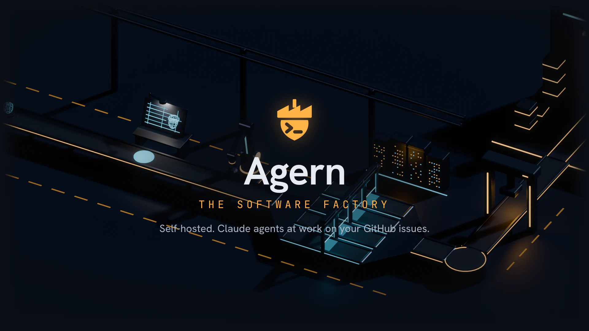

<p align="center">
  
</p>

<h1 align="center">Agern</h1>

<p align="center">
  <b>A self-hosted software factory: put Claude agents to work on your GitHub issues.</b><br>
  <sub>"Agern" is Danish for acorn.</sub>
</p>

<p align="center">
  
</p>

<p align="center">
  <a href="docs/media/agern-concept.mp4">
    
  </a><br>
  <sub><a href="docs/media/agern-concept.mp4">▶ Watch the concept video (67 s)</a></sub>
</p>

Agern is a web application you run on your own machine. A GitHub organization is the source of
truth: **repositories are projects** and **issues are the work**. Every project has a terminal-like
chat with a Claude agent, and that agent — or a person — can start a *pipeline run* in which a team
of agents takes an issue from spec to merged pull request:

```
issue ─▶ spec-writer ─▶ builder ─┬─▶ security  ─┐
            (opus)       (opus)  ├─▶ ux         │  all four in parallel,
                           ▲     ├─▶ ui-design  │  read-only, verdict PASS / CHANGES
                           │     └─▶ code      ─┘
                           └──── CHANGES: the same builder conversation fixes (max 2 rounds)
                                 all PASS ─▶ approver (opus) ─┬─ APPROVE  ─▶ squash-merge, close issue
                                                              └─ ESCALATE ─▶ needs-human ─▶ owner approves
```

The orchestration is a deterministic state machine in the server, not something a model decides.
Models per role are a setting. The details are in [`docs/ARCHITECTURE.md`](docs/ARCHITECTURE.md).

## Features

- **Per-user Claude credentials and the ownership rule.** Each person registers their own Claude
  credential (a `claude setup-token` OAuth token or an Anthropic API key) and their own GitHub
  token, stored encrypted (AES-256-GCM). An agent always runs with the credentials of the person
  who started it; nobody can make an agent run on someone else's account. Only the owner can drive
  a session or run (input, interrupt, approve); admins can stop or cancel but never drive.
- **Mandatory two-factor authentication.** Login is a password (OS account via PAM, LDAP) followed by
  a TOTP code from an authenticator app, enrolled on first login, with single-use recovery codes.
  TOTP works over plain HTTP on a LAN. It cannot be switched off outside the development login mode.
- **GitHub is the source of truth.** Projects and issues come from the organization. You see a
  project only if your own GitHub token can read the repository, and every GitHub call made for you
  uses your token, so GitHub enforces access.
- **Live observation.** Chats and pipeline stages stream live over WebSockets, rendered the way the
  terminal shows them (streamed text, tool calls, cost per turn). Anyone who can read the repository
  can watch; sessions owned by someone else are read-only.
- **Agents can use the factory.** The chat agent gets factory tools over MCP (list and create issues,
  start, approve and cancel runs), and `/factory run|status|approve|cancel|retry` works in the chat.
- **Generated images.** Each person can register an image AI under Settings: OpenAI or Google Gemini
  with their own API key and model, or OpenAI Codex signed in with their own ChatGPT account. When a request or issue asks for an icon, illustration or other graphics,
  the chat agent, spec-writer and builder have them generated on the server with the owner's key; chat
  images can be picked for an issue and are handed to its run, run images show on the run page.
- **Talk to an agent when a run needs a human.** Before approving an escalated run, its owner can ask an
  agent about the run's diff and findings, or ask it for a change, which is pushed and reviewed again by the
  four reviewers before the run can be approved. Talking never approves anything.
- **Retry without losing work.** A failed run can retry just the step that failed (a refused push, a
  pull request, a merge), continue from its commits in a new run that reuses its spec, or start over;
  the sensible choice is preselected with a one-line reason. Builders are warned before the stage time
  limit so they can commit and leave a hand-over note.
- **Build and test sandboxes (optional).** A project describes a container for its builds and tests
  in `.agern/sandbox.yml` — toolchain image, setup script, sidecar services such as PostgreSQL with a
  readiness check, caches, a non-root user, and extra *platform* images to test on. After an admin
  approves the file, each run's builder builds and tests in its own rootless Podman container. Off by
  default; see [`docs/SANDBOXES.md`](docs/SANDBOXES.md) (this repository has its own, `.agern/sandbox.yml`).
- **Native and small.** One self-contained `agern.jar` (server with the frontend embedded), Java 17
  and a natively installed PostgreSQL. No Docker needed for Agern itself.

## Security: read this first

**In v1 all agents run as the same OS user — the service user — with Claude's permission checks
bypassed** (`--permission-mode bypassPermissions`). Agents of different people can therefore read
each other's workspaces and anything else that user can read on the machine. Run Agern on a
**dedicated machine or VM** that holds nothing else of value. Per-user OS accounts or containers
are the planned hardening (`AgentLauncher` is an interface for that reason).

The installer keeps the code read-only to the service user, never runs Agern as root, and the
systemd unit adds hardening that still lets agents build software. That does not change the point
above.

## Development

Requires JDK 17, Node.js and Docker (only for a throwaway PostgreSQL).

```sh
docker compose -f docker-compose.dev.yml up -d          # PostgreSQL on localhost:54329

export FACTORY_DB_URL=jdbc:postgresql://localhost:54329/factory
export FACTORY_MASTER_KEY=$(openssl rand -base64 32)    # keep it stable across restarts
export FACTORY_GITHUB_ORG=Egernet-CS
export FACTORY_AUTH=dev FACTORY_DEV_USERS=alice:alice-pw,bob:bob-pw FACTORY_ADMINS=alice
export FACTORY_ALLOWED_ORIGINS=http://localhost:5173
# No GitHub and no tokens spent: an in-memory GitHub org and a stand-in for the claude CLI
export FACTORY_DEV_FAKE_GITHUB=true
export FACTORY_CLAUDE_BIN=$PWD/server/src/test/resources/fake-claude
./gradlew :server:run                                   # API on :8080

cd web && npm ci && npm run dev                         # UI on http://localhost:5173
```

Log in as `alice` / `alice-pw` (the first login enrols TOTP) and register the GitHub token
`fake-alice` in Settings. The fake GitHub has the repositories `demo-app` and `private-lab`; the fake
Claude answers chats and walks pipeline runs through every stage, with switches in the issue body
for review rounds, escalation and failures — see [`server/README.md`](server/README.md).
`npm run dev:mock` runs the UI against simulated data without any backend.

Tests: `./gradlew build` (the server tests start their own embedded PostgreSQL), and
`npm run typecheck && npm run lint` in `web/`.

End-to-end (browser → real server in fake mode), with the dev PostgreSQL container running:

```sh
cd web && npm run e2e
```

The Playwright suite (`web/e2e/`) builds the server and the frontend, starts Agern on a free port
with a fresh database (dropped afterwards), fake GitHub and fake Claude, and drives login with TOTP,
settings, projects, chat (streaming, tools, interrupt, observing), pipeline runs (fix round,
escalation and approval) and the admin page. `npm run e2e:server` starts the same server by itself
for manual use. Playwright needs its Chromium (`npx playwright install chromium`) or
`CHROMIUM_PATH=<chromium binary>`; `E2E_SCREENSHOTS=<dir>` also captures desktop and phone
screenshots of the main screens.

## Production install

Agern runs directly on one host on your network: **Linux with systemd** or **macOS with launchd**.

**Debian 13 (recommended) or Ubuntu 24.04: use the Debian package** — it brings its dependencies,
upgrades with `apt`/`agern upgrade`, can upgrade itself when idle, and is how a machine that
develops Agern with Agern is set up. Step by step, from an empty VM (Proxmox notes included):
**[docs/INSTALL-LINUX.md](docs/INSTALL-LINUX.md)**. In short:

```sh
sudo apt install postgresql
base=https://github.com/Egernet-CS/agern/releases/latest/download
curl -fsSLO "$base/SHA256SUMS" && deb=$(grep -o 'agern_[^ ]*_all\.deb' SHA256SUMS)
curl -fsSLO "$base/$deb" && sha256sum --check --ignore-missing SHA256SUMS
sudo apt install "./$deb"
sudo agern setup-db                 # role, database, FACTORY_DB_* in /etc/agern/agern.env
sudoedit /etc/agern/agern.env       # FACTORY_GITHUB_ORG, FACTORY_PUBLIC_URL, FACTORY_ADMINS, FACTORY_AUTH
sudo agern doctor && sudo agern start
```

**Other Linux distributions and macOS: the tarball installer** below. The host needs:

- Java 17 or newer
- PostgreSQL 16, installed natively
- `claude`, `git` and `gh` on the service's `PATH` (agents are `claude` processes started by the
  server; they use `git` and `gh`)
- Recommended: a headless browser (`chromium`, `chromium-browser`, `google-chrome`) on that `PATH`, so the
  UX and UI design reviewers can run the app under review and attach screenshots (`agern doctor` checks it)
- Optional: the OpenAI `codex` CLI, for users who generate images with their ChatGPT login (`FACTORY_CODEX_BIN`)
- `curl`, `tar` and `openssl` for the installer

**1. Database.** Create a role and a database (Flyway creates and migrates the schema on startup):

```sh
sudo -u postgres createuser --pwprompt factory
sudo -u postgres createdb --owner=factory factory
```

**2. Install** the latest release (the installer downloads the release tarball and verifies it
against the release's `SHA256SUMS`):

```sh
curl -fsSLO https://github.com/Egernet-CS/agern/releases/latest/download/install.sh
sudo bash install.sh                    # or: sudo bash install.sh --version 1.2.3
```

This creates the unprivileged service user `agern`, installs to `/opt/agern`, links
`/usr/local/bin/agern` (when that directory exists), writes `/etc/agern/agern.env` with a freshly generated
`FACTORY_MASTER_KEY` (mode `0600`, never overwritten by later installs, the key is never printed)
and registers the service (`agern.service`, or `dk.egernet.agern` in `/Library/LaunchDaemons`).
It does not start Agern on a first install.

**3. Configure** `/etc/agern/agern.env`: at least `FACTORY_DB_PASSWORD`, `FACTORY_PUBLIC_URL` (the
URL people type in their browser — requests from other origins are rejected), `FACTORY_GITHUB_ORG`,
`FACTORY_ADMINS` and `FACTORY_AUTH`. **Back up `FACTORY_MASTER_KEY`**: without it every stored
credential and 2FA secret is unreadable.

**4. Check and start:**

```sh
sudo agern doctor     # Java, PostgreSQL login, claude/git/gh, data directory, 2FA not disabled, …
sudo agern start      # waits until /api/health answers
```

| Path | Linux | macOS |
|---|---|---|
| Program | `/opt/agern` (`versions/<v>`, `current`, `previous`) | same |
| Configuration | `/etc/agern/agern.env` (root, `0600`, read by systemd) | `/etc/agern/agern.env` (`agern`, `0600`) |
| Data (workspaces, per-user homes) | `/var/lib/agern` | `/usr/local/var/agern` |
| Logs | journald (`agern logs`) | `/usr/local/var/log/agern/agern.log` |

Notes:

- **`os` login on Linux** checks passwords with PAM. `pam_unix` can only verify *other* users'
  passwords when the service user can read `/etc/shadow` (membership in the `shadow` group). The
  installer does not grant this, because every agent would then be able to read the password
  hashes as well; decide for yourself, or use LDAP (`FACTORY_AUTH=ldap`).
- **Java not on the PATH** (e.g. Homebrew's keg-only `openjdk@17`): set `AGERN_JAVA` in
  `agern.env`. `AGERN_JAVA_OPTS` adds JVM options.
- **Tool locations:** the service gets a fixed `PATH` (shown by the installer); set
  `FACTORY_AGENT_PATH` in `agern.env` to change what the server and its agents see.
- **Without root** — for trying it out, or a host without a service manager — set `AGERN_PREFIX`:
  everything (config, data, logs, pid file) then lives under that directory and `agern start` runs
  the server in the background as you.

## Configuration

All configuration is `FACTORY_*` environment variables, read from `/etc/agern/agern.env` by the
service. Every variable is described in [`docs/ARCHITECTURE.md` §3](docs/ARCHITECTURE.md#3-configuration-environment-variables)
and annotated in [`.env.example`](.env.example). The file is plain `KEY=value` lines (no shell
expansion).

## Operating

```sh
agern status | start | stop | restart
agern logs [-f] [-n 200]
agern version                 # installed, previous, and what /api/health reports
agern upgrade                 # latest release      — or: agern upgrade 1.2.3
agern rollback                # back to the previous version
agern doctor
# .deb installs also:
agern upgrade --channel main  # newest build of main;  --file ./agern_1.2.3_all.deb  installs a file
agern setup-db                # PostgreSQL role and database on the local server
agern auto-upgrade on|off|status   # install new versions automatically when no agent is working
```

On `.deb` installs `agern upgrade` verifies the package against the release's `SHA256SUMS`,
installs it with `apt-get` and keeps the previous package for `agern rollback`; it waits while
runs or agents are active (`--force` overrides). See
[docs/INSTALL-LINUX.md §8](docs/INSTALL-LINUX.md#8-upgrades-rollback-and-automatic-upgrades).
For tarball installs:

`agern upgrade` downloads the release tarball from GitHub Releases, verifies its SHA-256 against
the release's `SHA256SUMS` (refusing on mismatch before anything changes), unpacks it next to the
current version, switches `current` (the old one becomes `previous`), restarts and waits until
`/api/health` reports the new version. If it does not, it switches back and restarts the previous
version automatically. Database migrations run on startup; a rollback does not undo them, so
rolling back across a schema change is only safe if the older version tolerates the newer schema.
Unfinished pipeline runs are marked failed when the server restarts (v1).

The checksum protects against corrupted or truncated downloads; it comes from the same GitHub
release as the tarball, so it is not a signature.

## Releasing

```sh
scripts/release.sh 1.2.0              # or --dry-run first
```

The script checks that the version is semantic, the tree is clean, you are on `main` and level with
`origin/main`, and the tag does not exist; then it creates and pushes the annotated tag `v1.2.0`.
Nothing is built locally. The [release workflow](.github/workflows/release.yml) then runs the
frontend checks and server tests, builds the jar with that version (`scripts/package.sh`, which you
can also run locally; `--deb` needs `dpkg-deb`) and publishes a GitHub Release with
`agern-1.2.0.tar.gz`, `install.sh`, `agern_1.2.0_all.deb` and `SHA256SUMS`. Versions with a suffix
(`1.3.0-rc.1`) become pre-releases, which `agern upgrade` without a version ignores. Every push to
`main` also publishes a `.deb` as the rolling pre-release `main-latest` (the `main` channel).

## Repository

```
server/      Kotlin + Ktor backend          web/        React + TypeScript frontend
packaging/   installer, agern CLI, service units, deb/ (Debian package)
scripts/     release.sh, package.sh, main-version.sh
docs/        architecture and API contract, INSTALL-LINUX.md, SANDBOXES.md (for project authors)
art/         Blender sources of the artwork
```

## License

Copyright 2026 Egernet.

Agern is licensed under the Apache License, Version 2.0 — see [LICENSE](LICENSE) and
[NOTICE](NOTICE). Unless you explicitly state otherwise, any contribution you intentionally submit
for inclusion in Agern is licensed under the same terms, without any additional terms or conditions.

Not covered by this license: third-party libraries and the bundled fonts (JetBrains Mono and
Hanken Grotesk, SIL Open Font License 1.1) keep their own licenses, and the music in
`docs/media/agern-concept.mp4` ("Technology" by Eliveta) is used under the Pixabay Content License
and may not be extracted or redistributed on its own.
